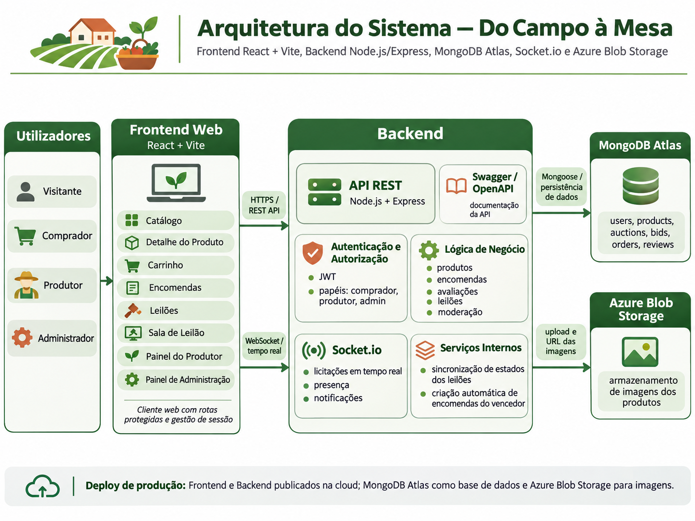
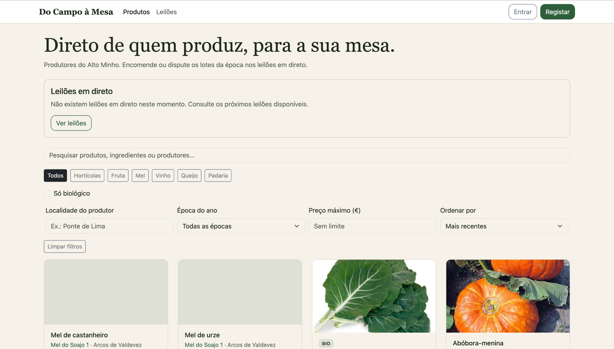
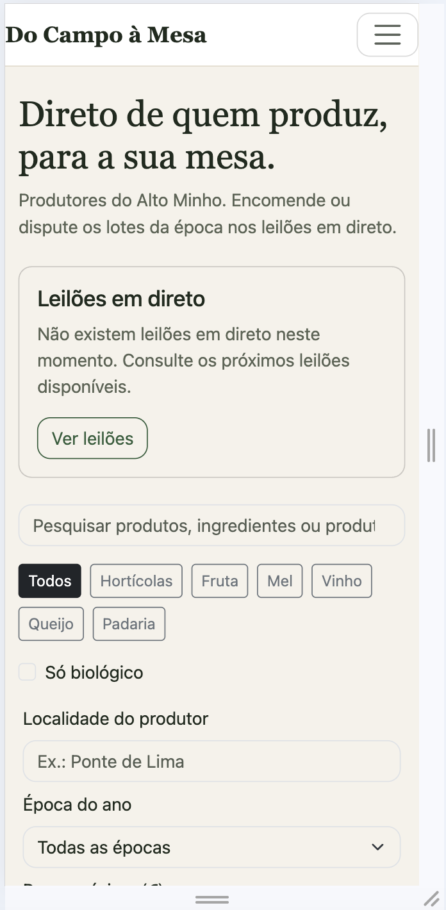
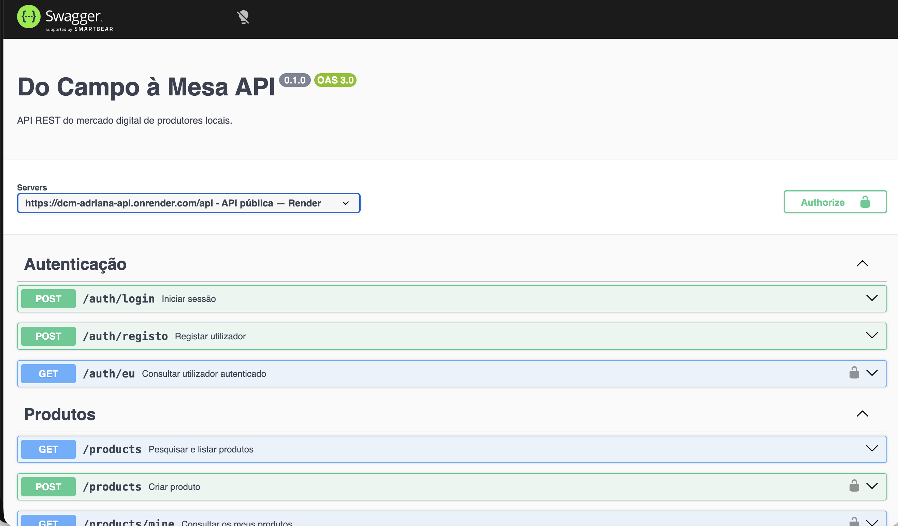
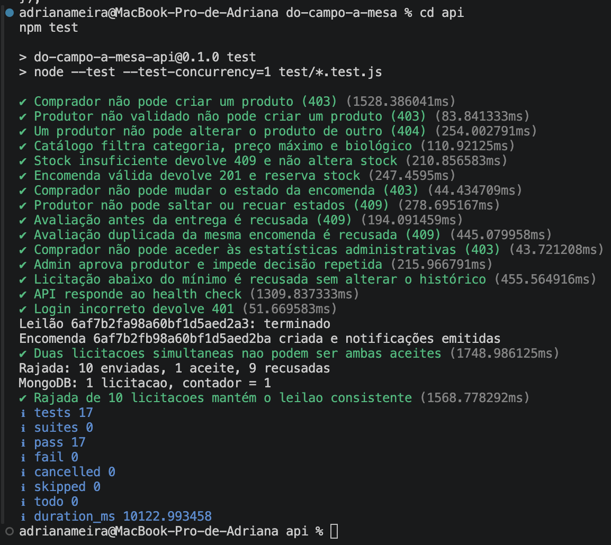
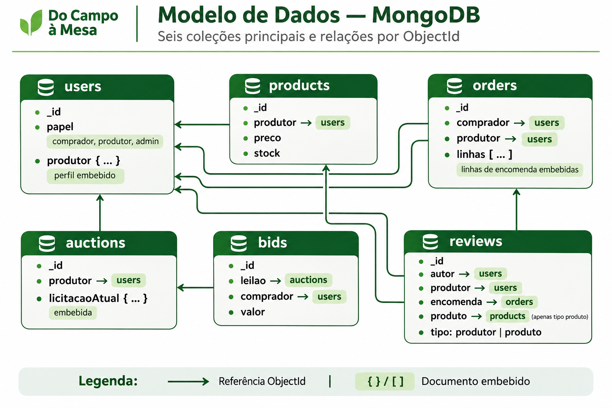
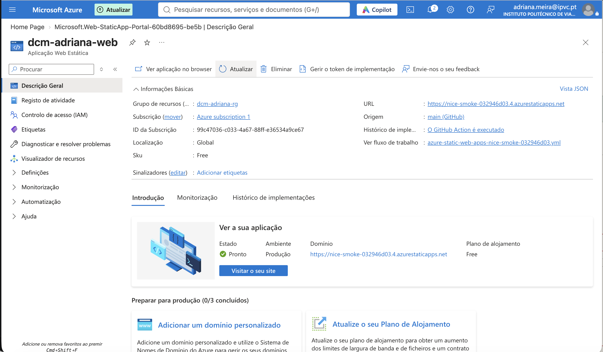
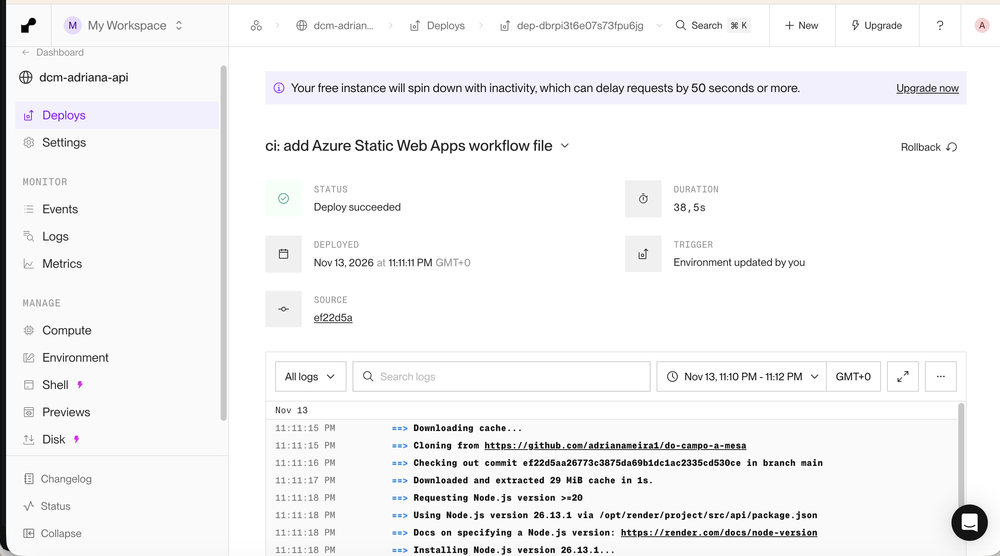

# Relatório · Do Campo à Mesa

**Unidade curricular:** Desenvolvimento Web Cliente  
**Projeto:** Do Campo à Mesa  
**Autora:** Adriana Meira  
**Versão:** relatório técnico — novembro de 2026

## 1. Introdução

O projeto *Do Campo à Mesa* consiste numa plataforma web que aproxima produtores agrícolas e compradores, permitindo descobrir produtos locais, consultar produtores, efetuar encomendas e participar em leilões de lotes agrícolas. A aplicação inclui ainda avaliações, moderação e funcionalidades de administração.

O trabalho foi desenvolvido como uma aplicação *Single-Page Application* (SPA), com frontend React, API REST em Node.js/Express, persistência em MongoDB e comunicação bidirecional em tempo real através de Socket.io. A implementação foi publicada em serviços Cloud e testada com cenários funcionais e de concorrência.

O principal desafio técnico foi assegurar a consistência das licitações quando chegam pedidos simultâneos, sem permitir que ofertas concorrentes com o mesmo valor sejam registadas como vencedoras.

## 2. Arquitetura

A arquitetura separa apresentação, regras de negócio, comunicação em tempo real e persistência. O frontend React é disponibilizado através do Azure Static Web Apps; a API Node.js/Express e o servidor Socket.io são executados no Render. Os dados estruturados persistem no MongoDB Atlas e as fotografias dos produtos são guardadas no Azure Blob Storage.



*Figura 1 — Arquitetura do sistema: frontend, API REST, Socket.io e serviços Cloud.*

As comunicações públicas utilizam HTTPS. A API expõe recursos de autenticação, produtos, produtores, encomendas, leilões, avaliações e administração. A ligação Socket.io permite acompanhar licitações, estados e notificações sem atualização manual da página.

Esta divisão facilita a manutenção: o frontend apresenta os dados e gere a interação; o backend valida permissões e operações; os serviços externos asseguram armazenamento e publicação.

## 3. Frontend e SPA

O frontend utiliza React, Vite e React Router. A navegação ocorre dentro da SPA, permitindo alternar entre catálogo, páginas de produtores, leilões, encomendas e áreas privadas sem recarregamento integral da aplicação. O acesso às páginas protegidas depende da autenticação e do papel do utilizador.

Os principais estados partilhados são geridos por contextos React, designadamente autenticação, carrinho e ligação Socket.io. A sessão e o carrinho por utilizador são conservados no `localStorage`; esta opção melhora a continuidade da experiência, mas exige atenção à segurança de conteúdo executado no navegador.

A interface foi construída com Bootstrap e Sass, usando variáveis, *mixins* e ficheiros parciais. A abordagem *Mobile First* define primeiro a apresentação em ecrãs pequenos e ajusta a disposição para larguras superiores, incluindo os pontos de quebra de 768 px, 1024 px e 1280 px. No catálogo, por exemplo, a grelha adapta o número de colunas ao espaço disponível.

As Figuras 2 e 3 ilustram a apresentação do catálogo em ambiente desktop e móvel, respetivamente.



*Figura 2 — Catálogo da aplicação na versão desktop.*



*Figura 3 — Catálogo da aplicação na versão móvel.*

Foram verificados em ambiente publicado a consulta e filtragem de produtos, páginas públicas dos produtores, autenticação, carrinho, encomendas e áreas de produtor e administração. Os leilões foram utilizados com duas sessões de comprador para comprovar a atualização em tempo real.

## 4. API REST e documentação

A API foi implementada com Node.js e Express, com recursos organizados por responsabilidade e respostas maioritariamente em JSON. Estão disponíveis métodos `GET`, `POST`, `PUT`, `PATCH` e `DELETE`, com validação de parâmetros, autenticação e verificação de permissões sempre que necessário. Os estados HTTP utilizados incluem `200`, `201`, `204`, `400`, `401`, `403`, `404` e `409`, de acordo com os cenários.

### 4.1. Documentação com OpenAPI e Swagger UI



*Figura 4 — Documentação interativa da API disponibilizada através do Swagger UI.*

A especificação utiliza OpenAPI 3.0.3, no ficheiro `api/openapi.yaml`. Foram identificadas e documentadas **37 operações HTTP**, incluindo `/api/health`. A interface Swagger UI pode ser consultada localmente em `http://localhost:3000/api-docs/` e em produção em `https://dcm-adriana-api.onrender.com/api-docs/`.

A documentação descreve recursos, parâmetros, pedidos e respostas e a autenticação JWT nas rotas protegidas. O comando `npx --yes @redocly/cli@1 lint api/openapi.yaml` validou a especificação com **zero erros e quatro avisos não bloqueantes**: licença em falta no campo `info`, URL local de desenvolvimento e ausência de resposta `4XX` documentada em dois endpoints públicos (`/producers` e `/health`). A contagem de 37 operações confirma a cobertura de métodos e caminhos identificados, não constituindo, por si só, uma validação exaustiva da precisão de todos os *schemas* de resposta.

### 4.2. Testes funcionais e de integração



*Figura 5 — Execução dos 17 testes E2E, sem falhas.*

O conjunto automatizado utiliza o *test runner* do Node.js e uma base MongoDB Atlas separada (`dcm_e2e_test`), protegida por verificações que impedem a utilização acidental da URI de produção. O comando `npm test`, executado na pasta `api`, terminou com **17 testes aprovados, zero falhas**, numa execução de aproximadamente 9,66 segundos.

Os cenários abrangem autenticação inválida, autorização por papel, aprovação de produtores, isolamento dos recursos de cada produtor, filtros do catálogo, stock insuficiente, criação de encomendas, transições de estados, avaliações prematuras ou duplicadas e permissões administrativas. Foram também testadas licitações inválidas, concorrência entre duas ofertas e uma rajada de dez pedidos com o mesmo valor.

Na rajada de dez licitações de 105 € sobre um leilão com preço atual de 100 € e incremento mínimo de 5 €, foi aceite uma única oferta e recusadas nove. O MongoDB manteve um registo no histórico e o contador do leilão igual a um. Noutro cenário, o encerramento do leilão criou uma única encomenda para o vencedor. Estes resultados comprovam os comportamentos observados nos casos testados, sem dispensar a análise de outros níveis de carga em produção.

## 5. Modelo de dados

A aplicação *Do Campo à Mesa* utiliza MongoDB Atlas como sistema de gestão de base de dados NoSQL, com Mongoose para definir os esquemas, as relações e as validações dos documentos.

O modelo de dados está organizado em seis coleções principais: `users`, `products`, `orders`, `reviews`, `auctions` e `bids`. A modelação combina documentos embebidos (*embedding*) e referências entre coleções (*referencing*), de acordo com a forma como os dados são consultados e atualizados.

### 5.1. Coleções e relações



*Figura 6 — Modelo de dados MongoDB com seis coleções principais e referências entre documentos.*

A coleção `users` armazena os utilizadores da plataforma, distinguindo compradores, produtores e administradores através do campo `papel`. Os dados específicos da exploração agrícola, como o nome, a descrição e a localização, são incorporados no documento do produtor.

A coleção `products` contém os produtos disponibilizados pelos produtores, incluindo nome, categoria, preço, stock, certificação biológica e épocas de disponibilidade. Cada produto referencia o respetivo produtor através de um identificador `ObjectId`.

A coleção `orders` guarda as encomendas efetuadas pelos compradores. Cada encomenda referencia o comprador e o produtor e contém uma lista de linhas embebidas, com o produto, nome, preço unitário e quantidade adquirida.

A coleção `reviews` armazena as avaliações dos compradores, incluindo a classificação, comentário, número de denúncias e estado de visibilidade. Cada avaliação referencia o autor e o produtor, podendo também estar associada a um produto e a uma encomenda.

A coleção `auctions` contém os leilões, com informações sobre o lote, preço base, incremento mínimo, datas de início e fim, estado e licitação atual. Cada leilão referencia o produtor e, quando aplicável, o produto associado.

Por fim, a coleção `bids` regista individualmente as licitações, mantendo referências ao leilão e ao comprador, bem como o valor e a data de criação.

### 5.2. Decisões de embedding e referencing

A estratégia de modelação foi definida tendo em conta os padrões de acesso aos dados, a consistência da informação e o crescimento das coleções.

Os dados específicos da exploração agrícola são embebidos no documento do utilizador, porque pertencem ao perfil do produtor e são normalmente consultados em conjunto.

Nas encomendas, as linhas são igualmente embebidas, permitindo obter toda a informação necessária numa única consulta. O nome e o preço unitário são copiados no momento da compra, preservando o histórico mesmo que os dados do produto sejam alterados posteriormente. O comprador e o produtor são mantidos como referências, evitando a duplicação dos respetivos perfis.

As avaliações foram mantidas numa coleção independente, em vez de serem incorporadas nos documentos dos produtos ou produtores. Esta decisão permite consultar, denunciar e moderar cada avaliação individualmente, facilita a criação de índices e evita o crescimento contínuo dos documentos associados.

As licitações também são armazenadas numa coleção própria, uma vez que um leilão pode receber um elevado número de propostas. Esta separação permite consultar o histórico de licitações sem aumentar continuamente o tamanho do documento do leilão.

Os produtos mantêm uma referência ao respetivo produtor, em vez de incorporarem os seus dados. Esta decisão evita a duplicação de informação, uma vez que um produtor pode disponibilizar vários produtos. Assim, alterações aos dados da exploração não exigem a atualização de todos os produtos associados.

Nos leilões, a licitação atual é embebida no documento do próprio leilão, permitindo validar e atualizar o valor da proposta de forma atómica. Esta abordagem é fundamental para garantir a consistência das licitações concorrentes. O histórico completo permanece numa coleção independente (`bids`), evitando o crescimento ilimitado do documento do leilão.

### 5.3. Índices e otimização das consultas

Os modelos Mongoose definem índices de apoio às consultas e, quando aplicável, restrições de unicidade.

Nos produtos, os índices permitem apoiar consultas por produtor, categoria, preço e data de criação. Nas encomendas, foram criados índices compostos para consultar o histórico de cada comprador e as encomendas recebidas por cada produtor, ordenadas por data.

Nas avaliações, os índices compostos combinam o produtor ou produto com a visibilidade e a data de criação. O modelo `Review.js` define também dois índices únicos parciais: `{ autor: 1, encomenda: 1 }` para avaliações do tipo `produtor`, e `{ autor: 1, encomenda: 1, produto: 1 }` para avaliações do tipo `produto`. Deste modo, um comprador pode avaliar o produtor uma vez por encomenda e avaliar individualmente cada produto adquirido, sem duplicações para o mesmo produto e encomenda.

Nos leilões, os índices apoiam a consulta por estado, produtor e data de início. Nas licitações, um índice composto permite consultar as propostas de um leilão por ordem cronológica decrescente, utilizando o identificador como critério adicional de ordenação.

A criação dos índices foi confirmada no MongoDB Atlas através do separador *Indexes*. A sua existência não garante que sejam utilizados em todas as consultas, uma vez que o MongoDB seleciona o plano de execução de acordo com os dados disponíveis e as características da pesquisa.

### 5.4. Validação e consistência dos dados

Os esquemas Mongoose incluem validações para impedir valores inválidos, como preços negativos, quantidades não inteiras nas encomendas, classificações fora do intervalo de 1 a 5 e números de denúncias negativos.

Na criação de encomendas, a API valida as quantidades solicitadas e utiliza transações MongoDB para atualizar o stock e criar as encomendas de forma consistente. As linhas preservam o preço e o nome dos produtos no momento da compra.

Os testes automáticos de integração foram executados contra a base de dados exclusiva `dcm_e2e_test`, utilizando os modelos Mongoose e pedidos reais à API. A bateria de 17 testes aprovada é descrita na secção 4.2.

Adicionalmente, foi confirmada a consulta autenticada das encomendas através da API REST, verificando a compatibilidade dos dados existentes com os modelos atualizados.

Foram também realizados testes de integração à criação de encomendas e à atualização do stock através da API REST. Numa encomenda válida, confirmou-se a redução do stock de 10 para 7 unidades após a compra de três unidades, bem como a criação da encomenda no estado `pendente`.

Para verificar a consistência transacional, foi simulada uma encomenda com dois produtos, em que o primeiro tinha stock suficiente e o segundo não. A API rejeitou a operação com HTTP 409 (`Stock insuficiente`) e a consulta posterior ao MongoDB confirmou que os stocks permaneceram inalterados e que não foi criada nenhuma encomenda adicional. Este resultado demonstrou o funcionamento do rollback no cenário testado.

Foram ainda verificadas as transições sequenciais dos estados das encomendas, a rejeição de transições inválidas e a proteção contra alterações efetuadas por produtores não associados à encomenda.

### 5.5. Exemplos de consultas MongoDB

As consultas à base de dados são realizadas através do Mongoose, permitindo aplicar filtros e ordenações.

**Consulta de produtos por categoria e preço:**

```javascript
Product.find({
  categoria: 'Fruta',
  preco: { $lte: 5 }
}).sort({ preco: 1 });
```

Esta consulta seleciona produtos da categoria Fruta com preço até 5 €, ordenados por preço crescente.

**Consulta das encomendas de um comprador:**

```javascript
Order.find({
  comprador: compradorId
}).sort({ createdAt: -1 });
```

Permite consultar o histórico de encomendas de um comprador, apresentando primeiro as mais recentes.

**Consulta das avaliações visíveis de um produtor:**

```javascript
Review.find({
  produtor: produtorId,
  visivel: true
}).sort({ createdAt: -1 });
```

Esta consulta devolve as avaliações públicas de um produtor, ordenadas por data de criação decrescente.

Estes exemplos ilustram como os índices definidos podem apoiar as operações de consulta da aplicação.

## 6. Segurança

A autenticação utiliza JSON Web Tokens (JWT). No início de sessão, a API valida as credenciais e emite um token assinado, com prazo de validade configurável. Os endpoints protegidos exigem o cabeçalho `Authorization: Bearer <token>`.

As passwords são armazenadas no MongoDB sob a forma de hashes bcrypt, não sendo guardadas em texto simples nem devolvidas nas respostas. O registo público permite apenas contas de comprador e produtor; a criação de administradores através deste endpoint é impedida. Os produtores recém-registados ficam pendentes de aprovação administrativa.

A autorização utiliza controlo de acesso baseado em papéis (*Role-Based Access Control*). O middleware consulta o utilizador no MongoDB em cada pedido autenticado, utilizando o papel atual da conta em vez de confiar exclusivamente no papel incluído no JWT. As operações protegidas verificam igualmente a propriedade dos recursos, como produtos e encomendas.

A criação de produtos e leilões exige que o produtor esteja aprovado. Esta exigência foi também aplicada à edição e eliminação de produtos. A atualização de encomendas existentes mantém a verificação de que o produtor é o responsável pela encomenda.

Foram verificados cenários de autenticação e autorização, incluindo credenciais incorretas, tentativas de acesso administrativo por compradores e operações proibidas a produtores não aprovados. O middleware rejeita tokens ausentes, inválidos ou expirados e distingue erros HTTP 401 de 403.

No frontend, as sessões são mantidas no `localStorage`, o que permite conservar a autenticação após atualizar a página, mas exige especial atenção à prevenção de ataques XSS. Os carrinhos foram separados por identificador de utilizador, impedindo que contas diferentes no mesmo navegador partilhem os produtos adicionados.

A política CORS está configurada na API Express e no servidor Socket.io através da variável de ambiente `CLIENT_URL`. O servidor exige esta variável no arranque, e os navegadores apenas podem ler respostas de origens autorizadas pela política. O CORS complementa, mas não substitui, a autenticação JWT e o controlo de acesso.

As credenciais e os segredos de configuração são configurados por variáveis de ambiente fora do código-fonte. A pesquisa efetuada aos nomes dos ficheiros versionados não identificou ficheiros `.env` privados; os ficheiros `.env.example` são exemplos de configuração e o `.env.production` do frontend inclui apenas a URL pública da API e o modo de dados simulados. A aplicação publicada utiliza HTTPS. A rotação de quaisquer credenciais que tenham sido previamente expostas continua a ser uma medida de segurança necessária, independente desta verificação do repositório.

## 7. Tempo real e consistência dos leilões

A comunicação em tempo real utiliza Socket.io. Os clientes autenticados ligam-se ao servidor, entram nas salas correspondentes aos leilões e recebem eventos sobre o estado e as licitações. A interface acompanha a participação dos utilizadores, apresenta o histórico e recebe atualizações sem necessidade de atualizar a página. Foram também verificadas notificações relacionadas com encomendas e com a conclusão de leilões.

A consistência não depende do frontend: a validação das ofertas é efetuada no backend, considerando o estado e o prazo do leilão, o incremento mínimo e o valor atual. O serviço de licitações usa operações condicionais e transações MongoDB para impedir que dois pedidos concorrentes registem simultaneamente a mesma oferta como válida. O histórico das licitações é guardado na coleção `bids`, enquanto a licitação atual e o contador são mantidos no documento `auctions`.

O encerramento dos leilões é tratado pelo serviço de sincronização de estados. Quando existe vencedor, é gerada uma encomenda de origem `leilao`; as verificações de consistência e unicidade impediram duplicações no cenário testado. O teste com dez pedidos simultâneos, descrito na secção 4.2, é a principal evidência automatizada da proteção contra concorrência com ofertas iguais. Na aplicação publicada, dois compradores também observaram a atualização imediata das licitações.

O servidor sincroniza os estados ao arrancar e, em seguida, a cada cinco segundos, evitando a sobreposição de execuções na mesma instância através de uma variável de controlo.

## 8. Deployment na Cloud

As Figuras 7 e 8 identificam os serviços públicos de alojamento do frontend e da API.



*Figura 7 — Frontend publicado no Azure Static Web Apps.*



*Figura 8 — API Node.js e Socket.io publicada no Render.*

O deployment utiliza quatro serviços principais:

| Componente | Serviço | Justificação e modelo |
|---|---|---|
| SPA React | Azure Static Web Apps | Alojamento gerido de conteúdo web e integração de publicação; serviço gerido do tipo PaaS. |
| API REST e Socket.io | Render | Execução gerida da aplicação Node.js; PaaS. |
| Base de dados | MongoDB Atlas | Base de dados gerida, consumida como serviço (DBaaS, frequentemente classificada dentro de PaaS). |
| Imagens | Azure Blob Storage | Armazenamento de objetos gerido; serviço de armazenamento Cloud. |

Não foi necessário administrar máquinas virtuais, pelo que não foi contratada diretamente uma solução IaaS para executar a aplicação. Os serviços foram escolhidos para reduzir a configuração de infraestrutura e permitir uma demonstração pública do sistema.

**Endereços públicos:** frontend em `https://nice-smoke-032946d03.4.azurestaticapps.net` e API em `https://dcm-adriana-api.onrender.com`, com documentação em `/api-docs/` e verificação de saúde em `/api/health`. A aplicação foi verificada com HTTPS, autenticação, fotografias de produtos e atualizações de leilões entre sessões. A funcionalidade de upload guarda as imagens no Azure Blob Storage e associa a respetiva URL aos produtos.

Na implementação foram utilizadas opções de alojamento gratuitas ou de baixo custo, designadamente as modalidades gratuitas do Azure Static Web Apps, Render e MongoDB Atlas. O custo efetivamente faturado pelo Azure Blob Storage não foi apurado neste relatório; a utilização de serviços Cloud não garante despesa zero. As modalidades gratuitas podem impor limites de recursos e disponibilidade, incluindo períodos de inatividade no alojamento da API.

## 9. Dificuldades, limitações e trabalho futuro

Uma das dificuldades relevantes ocorreu na publicação da API no Azure App Service, cuja tentativa num plano gratuito não avançou por uma limitação de quota (`QuotaExceeded`). A solução adotada foi alojar a API Node.js no Render e manter o frontend no Azure Static Web Apps. A separação obrigou a confirmar URLs de produção, CORS, JWT, HTTPS e comunicação Socket.io entre origens diferentes.

Outra preocupação importante foi a consistência de operações que alteram vários documentos, como reserva de stock, licitações e criação de encomendas após o leilão. Foram usadas validações no backend e transações MongoDB; os testes automatizados verificaram conflitos e impedimento de efeitos parciais nos cenários cobertos.

Entre as limitações identificadas encontram-se a dependência da disponibilidade dos serviços gratuitos, o armazenamento da sessão no `localStorage` (com risco acrescido em caso de XSS) e o facto de os testes de concorrência não representarem um ensaio de carga abrangente. Adicionalmente, após o relógio de um leilão chegar a zero, a página pode manter temporariamente um estado visual desatualizado até ser recarregada, apesar de o backend já ter concluído o leilão e emitido as notificações. Como evolução futura, seria útil aprofundar testes de carga, acessibilidade, observabilidade e mecanismos de renovação/gestão de sessão. Estas possibilidades são melhorias futuras, não funcionalidades declaradas como implementadas.

## 10. Ferramentas utilizadas e declaração de IA

Foram utilizadas tecnologias e ferramentas compatíveis com a implementação: React, Vite, React Router, Bootstrap, Sass, Node.js, Express, Socket.io, Mongoose/MongoDB Atlas, JWT, bcrypt, Swagger UI/OpenAPI, Redocly CLI, Git/GitHub, Azure Static Web Apps, Azure Blob Storage e Render. A verificação automatizada utilizou o *test runner* do Node.js e clientes Socket.io de teste.

Durante o desenvolvimento foi utilizado o **ChatGPT como assistente de apoio técnico**, designadamente na análise do enunciado, organização do plano de implementação, esclarecimento de conceitos, revisão de código, apoio à preparação de testes, depuração e revisão da documentação. As sugestões foram avaliadas e testadas no projeto; a responsabilidade pela implementação, validação e entrega é da autora. A utilização de outras ferramentas de IA, caso tenha ocorrido, deve ser declarada pela autora na entrega.

## 11. Conclusão

O *Do Campo à Mesa* integra uma SPA de comércio local com API REST, base de dados documental, autenticação por papéis e funcionalidades em tempo real. O projeto foi disponibilizado publicamente em serviços Cloud e submetido a uma bateria de 17 testes E2E, todos aprovados na execução registada.

O resultado tecnicamente mais relevante foi a consistência dos leilões em ofertas concorrentes: no cenário de dez licitações de igual valor, apenas uma foi aceite e persistida, sem discrepância entre histórico e contador. Em conjunto com os testes de encomendas, permissões e stock, esta evidência sustenta o funcionamento dos principais fluxos implementados.
